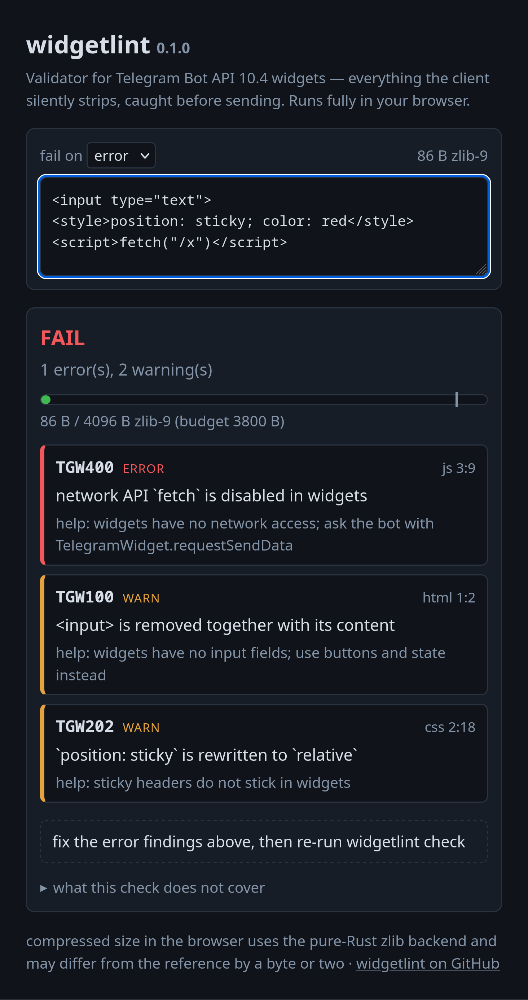

<!-- SPDX-FileCopyrightText: 2026 RAprogramm <andrey.rozanov.vl@gmail.com> -->
<!-- SPDX-License-Identifier: MIT -->

<div align="center">


**Validator and linter for Telegram Bot API 10.4 widgets**

Everything the client silently strips and everything the server refuses —
caught before you send.

[](https://github.com/RAprogramm/widgetlint/actions/workflows/ci.yml)
[](https://codecov.io/gh/RAprogramm/widgetlint)
[](https://app.codspeed.io/RAprogramm/widgetlint?utm_source=badge)
[](https://github.com/RAprogramm/widgetlint/releases/latest)
[](LICENSE)
[](https://api.reuse.software/info/github.com/RAprogramm/widgetlint)
[](rust-toolchain.toml)
[](docs/rules/index.md)
[](https://raprogramm.github.io/widgetlint/)

</div>



## Why this exists

A Telegram widget is an HTML/CSS/JS block rendered inside a message bubble in
a QuickJS sandbox with **no network**. It fails in two silent ways:

- **The server refuses it.** At most 32768 bytes of HTML and 4096 bytes after
  zlib level 9 compression — one byte over and the send fails.
- **The client silently strips it.** `<input>`, `fetch`, `alert()`,
  `position: sticky`, 3D transforms and dozens more are dropped or rewritten
  with no error, no warning, no console. You find out on a real phone.

`widgetlint` turns both failure classes into precise, actionable findings —
with exact spans, a fix hint and a stable fingerprint — from your editor,
your CI, or an LLM fix loop.

## Quick start

```console
cargo install --path crates/wl-cli
widgetlint check widget.html
```

```text
widget.html
  warn   TGW100  <input> is removed together with its content    14:3
         help: widgets have no input fields; use buttons and state instead
  error  TGW400  network API `fetch` is disabled in widgets    41:5
         help: widgets have no network access; ask the bot with TelegramWidget.requestSendData
1 error, 1 warning, 0 info
```

Or try it right now in the browser: **[live playground](https://raprogramm.github.io/widgetlint/)**
— the whole checker runs locally in WebAssembly, nothing is uploaded.

## For humans

```console
widgetlint check widgets/            # files, directories or - for stdin
widgetlint size widget.html          # exact zlib-9 size vs the hard limit and the budget
widgetlint explain TGW400            # what a rule means and how to fix it
widgetlint rules                     # the full rule reference
```

- **CI**: `widgetlint check --format sarif --fail-on error > r.sarif` feeds
  GitHub Code Scanning; exit codes `0` pass, `1` findings, `2` usage error.
- **Config**: `widgetlint.toml` in the working directory — thresholds, rule
  on/off and severity overrides, path include/exclude filters.
- **Suppressions in source**: `<!-- tgw-disable TGW100 -->`,
  `<!-- tgw-disable-file TGW100 -->`, `// tgw-disable-next-line TGW400`.
- **Size**: `size` reports raw and zlib-9 bytes with byte-for-byte parity
  against the Python `zlib` reference the Telegram server uses.

## For AI agents

The machine surface is designed for LLM fix loops — an agent that generates
widget code cannot know Telegram's restrictions, so it verifies instead:

```console
widgetlint check widget.html --format agent   # compact JSON report
widgetlint verify widget.html                 # minimal verdict between edits
widgetlint verify widget.html --since fp.txt  # only findings new since last run
widgetlint schema                             # JSON Schema of the report
```

```json
{"verdict":"fail","reason":"1 error(s), 2 warning(s)",
 "findings":[{"fp":"707112e9","id":"TGW400","sev":"error",
   "msg":"network API `fetch` is disabled in widgets",
   "where":{"line":3,"col":9},"fix":{"hint":"..."},"repeat":1}],
 "next_action":"fix the error findings above, then re-run widgetlint check"}
```

Findings are grouped with stable fingerprints, texts are capped for token
budgets, and `caveats` honestly disclose where a rule is heuristic. Paste the
ready agent instructions from [docs/agents.md](docs/agents.md) into your
widget project, and feed your model [llms.txt](llms.txt) or
[llms-full.txt](llms-full.txt) for the full rule reference.

### MCP server

Agents without a shell can drive the linter over the Model Context Protocol.
The server is part of the same binary and speaks over stdio:

```console
widgetlint mcp
```

```json
{
  "mcpServers": {
    "widgetlint": {
      "command": "widgetlint",
      "args": ["mcp"]
    }
  }
}
```

It exposes five tools: `check` (the full agent report), `verify` (the verdict
and the next action), `explain` (one rule), `rules` (the catalog) and
`schema` (the JSON Schema of the report). Nothing is read from disk: every
widget arrives as a tool parameter. See [docs/mcp.md](docs/mcp.md).

### GitHub Action

The repository ships a composite action, so a widget project needs three
lines and no installation:

```yaml
- uses: RAprogramm/widgetlint@v1
  with:
    path: widgets/
    fail-on: warn
```

The action downloads the release binary for the runner, verifies its SHA-256
checksum and checks the widgets. See [docs/action.md](docs/action.md).

## Rules

50 rules, all derived from the official
[widget documentation](https://core.telegram.org/bots/widgets), driven by a
single TOML ruleset — code, docs and machine output never disagree:

| Range | Region | Covers |
|---|---|---|
| TGW001–005 | size | raw and compressed limits, budget, invalid UTF-8 |
| TGW100–150 | HTML | stripped elements, dead attributes, SVG, schemes |
| TGW200–216 | CSS | unsupported features, fonts, unknown properties |
| TGW300–304 | limits | CSS rules, DOM nodes, text totals |
| TGW400–411 | JS | network, navigation, dialogs, focus, canvas |

Full reference: [docs/rules/index.md](docs/rules/index.md) — one page per
rule with spec links, generated from the ruleset.

## Status

Milestone M1 is complete: `check`, `size`, `verify`, `explain`, `rules`,
`schema`, `version`, the agent report and the WASM playground. The optimizer
(`pack`) and the client simulator (`sim`) follow per the roadmap in
[widget-linter-spec.md](widget-linter-spec.md).

## Development

```console
cargo build --workspace
cargo nextest run --workspace
cargo test --doc --workspace
cargo +nightly fmt --all --check
cargo clippy --workspace --all-targets --all-features -- -D warnings -W clippy::pedantic -W clippy::nursery
uv run --python 3.12 tools/zlib_parity.py   # size parity against real zlib
cargo run -p xtask -- gen-docs              # regenerate rule docs and llms.txt
```

The playground is built from the standalone `crates/wl-wasm` crate (it swaps
the size engine to the pure-Rust zlib backend, so it lives outside the
workspace on purpose):

```console
wasm-pack build crates/wl-wasm --target web --out-dir ../../playground/pkg
python3 -m http.server -d playground 8000    # then open http://localhost:8000
```

Contributors and coding agents: see [AGENTS.md](AGENTS.md).
Design documents: `widget-linter-spec.md`, `widget-linter-engineering.md`,
`widget-linter-ai-native.md`.

The CI pipeline, the release flow and the repository secrets are described in
[docs/ci.md](docs/ci.md) and [SECRETS_SETUP.md](SECRETS_SETUP.md).

## Support

`widgetlint` is free and open source. If it saves you from debugging silent
widget failures, you can support its maintenance:

- ⭐ Star the repository — it is the cheapest way to help.
- 🐛 Report a widget that the linter misses. A real broken widget is the most
  valuable input the project can get.
- 💖 [Sponsor the work](https://github.com/RAprogramm/RAprogramm/blob/main/SPONSOR.md).
  Support funds the time spent on new rules, on tracking Telegram Bot API
  updates, and on keeping the WASM playground alive.

## License

MIT — see [LICENSE](LICENSE).
